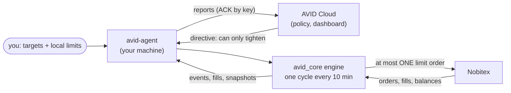

<p align="center"></p>

<p align="center">


</p>
<!-- After publishing, add the CI badge with the real repository path:
[](https://github.com/mshamsk138/avid/actions/workflows/ci.yml) -->

# AVID — an auditable fixed-weight rebalancer for Nobitex

AVID keeps a small crypto portfolio (BTC, PAXG, USDT) at the target weights you choose, by placing at
most **one** small resting limit order per cycle on Nobitex `<ASSET>USDT` markets. It is built to fail
safe: every decision, limit, order state and financial record can be inspected, reproduced and audited.

فارسی: [README_FA.md](README_FA.md)

## Contents

[Status](#status) · [What AVID is](#what-avid-is) · [What AVID is not](#what-avid-is-not) ·
[Features](#features) · [Safety model](#safety-model) · [How it works](#how-it-works) ·
[Supported exchange and markets](#supported-exchange-and-markets) · [Requirements](#requirements) ·
[Installation](#installation) · [Quick start: offline simulation](#quick-start-offline-simulation) ·
[Example output](#example-output) · [Configuration and limits](#configuration-and-limits) ·
[From simulation to live](#from-simulation-to-live) · [The Private Agent and AVID Cloud](#the-private-agent-and-avid-cloud) ·
[Commands](#commands) · [Testing](#testing) · [Security](#security) · [Documentation](#documentation) ·
[Project](#project) · [License and disclaimer](#license-and-disclaimer)

## Status

**Alpha, version 0.1.0a2.** Not production-ready. Not validated with live trading: the Nobitex
contract tests have not been run on the official testnet yet, and AVID Cloud must implement protocol v2
before the agent can trade. Real trading is **off by default**. Read [KNOWN_ISSUES.md](KNOWN_ISSUES.md)
and [the release readiness report](docs/audits/RELEASE_READINESS.md) before using real money.

## What AVID is

* `avid_core` — the engine: strategy, risk checks, explicit order state machine, Nobitex client,
  durable ledger, reconciliation, offline simulator. Runs on its own: `avid-engine`.
* `avid_agent` — the Private Agent: runs the engine on **your** machine under **your** local hard
  limits and takes directives from AVID Cloud (a separate service, not in this repository):
  `avid-agent`.

Your Nobitex API key stays on your machine and is never sent to the cloud.

## What AVID is not

* Not a profit machine. Rebalancing keeps weights; it does not predict prices and **does not guarantee
  a profit** - in a trending market it can end below simply holding.
* Not a high-frequency or arbitrage bot: one small order per cycle (default every 10 minutes).
* Not multi-exchange: Nobitex only.
* Not custody: no withdrawals, no leverage, no market orders.

## Features

* Fixed target weights with USDT as the hub; relative band; sells before buys.
* Exact order sizing in `Decimal` on the exchange's grid (step, tick, minimum notional).
* Per-order, per-day count and per-day notional caps; cash floor; spread limit.
* Explicit order state machine; durable intent and clientOrderId before every send.
* Execution-level reconciliation against the trade history, with honest statuses.
* Offline simulator that runs the **real** engine on stored synthetic prices.
* Human-readable output and `--json` everywhere; every event logged with an id and a severity.
* Background service via systemd `--user`: no root; stop cancels the bot's own orders and reports the
  result.
* No runtime dependencies (standard library only; `cryptography` optional, needed for live orders).

## Safety model

Each property below has tests ([security/test_findings.py](security/test_findings.py),
[tests/test_fuzz_invariants.py](tests/test_fuzz_invariants.py)):

* at most one bot order at a time; never trades next to your own open orders on a managed market;
* every risk number validated (no NaN or infinity tricks); invalid input stops new orders;
* an answer the engine does not understand is `UNKNOWN`: nothing is released and nothing new is placed
  until it is settled;
* a placement whose reply was lost is found again only by its clientOrderId, never re-sent;
* the cloud can only tighten limits and can never enable live trading by itself;
* STOP, dry mode, revocation, broken config files, exchange errors and even a full disk still cancel
  the bot's own orders;
* accounting is never reported complete when it is not (`RECONCILED` / `AGGREGATE_ONLY` /
  `INCOMPLETE_RECONCILIATION`).

Details: [docs/RISK_MODEL.md](docs/RISK_MODEL.md), [docs/SECURITY_ARCHITECTURE.md](docs/SECURITY_ARCHITECTURE.md).

## How it works



Each cycle: settle what is open, then value every managed asset, find the asset furthest outside its
band, size one order, run the risk checks, save the intent durably, send. The full component diagram is
in [docs/ARCHITECTURE.md](docs/ARCHITECTURE.md), the decision flow in
[docs/STRATEGY_MATH.md](docs/STRATEGY_MATH.md#decision-flow).

## Supported exchange and markets

| exchange | markets | network |
|---|---|---|
| Nobitex | `BTCUSDT`, `PAXGUSDT` (USDT as the hub) | mainnet, official testnet (`NOBITEX_NETWORK=testnet`) |

Market specs (amount step, price tick, minimum order of more than 11 USDT) follow the Nobitex
documentation and can be overridden by a validated `markets.json` if the exchange changes them.
Using a third-party exchange may be subject to sanctions and local law.

## Requirements

* Linux (systemd for the background service), Python 3.10-3.13 (CI matrix; 3.11-3.13 tested locally
  for this release, 3.10 by CI only).
* For live orders: `cryptography` (`sudo apt install -y python3-cryptography` or the `[live]` extra).

## Installation

AVID is not on PyPI yet. From a release wheel or the source:

```bash
python3 -m venv ~/.venvs/avid
~/.venvs/avid/bin/pip install avid_rebalancer-0.1.0a2-py3-none-any.whl     # or: pip install .
~/.venvs/avid/bin/avid-engine --version
```

Agent as a background service (no root): `avid-agent install`. Full guide, upgrade and uninstall:
[docs/INSTALLATION.md](docs/INSTALLATION.md).

## Quick start: offline simulation

No account, no credentials, no network:

```bash
avid-engine simulate --example btc-usdt
avid-engine simulate --example btc-paxg-usdt --json > sim.json
avid-engine simulate --scenario my-scenario.json
```

The simulation is **not** the live dry run: `avid-engine plan` reads your real account and shows what
the engine would do now, without sending or cancelling anything.

## Example output

200 USDT, target BTC 50 % / USDT 50 %, first step of the bundled synthetic price path (real output of
`avid-engine simulate --example btc-usdt`):

```text
First decision (step 1, 2026-01-05T18:00:00Z)
  Portfolio Value  200.00 USDT (estimated at mid prices)
  Current Weights  btc 0.0000  usdt 1.0000
  Target Weights   btc 0.5000  usdt 0.5000
  Band             ±25% of each target (btc 0.375-0.625, usdt 0.375-0.625)
  Decision         BUY order placed on the simulated exchange
  Order Amount     0.000333 BTC (BUY on BTCUSDT)
  Order Price      59988.0 USDT, limit (resting side); notional 19.98 USDT
  Risk Checks      cash_reserve OK (200.00 free - 20.54 (order + fee reserve + margin) = 179.46 USDT; floor 0); day_lock OK (not locked); orders_per_day OK (0 submitted today, cap 6); daily_notional OK (0.00 committed + 19.98 = 19.98 USDT, cap 100)
  Reason           btc weight 0.000 vs target 0.500
```

Over the whole 96-step run the engine places 5 orders (4 filled, 1 cancelled as stale) and stops once
BTC is inside its band (weight 0.40). These are simulated results on synthetic prices: estimated
values, not realized ones, and no indication of future returns. The maths:
[docs/STRATEGY_MATH.md](docs/STRATEGY_MATH.md#6-worked-example-offline-simulation-real-engine-output).

## Configuration and limits

| limit | default | meaning |
|---|---|---|
| `--weights` | `btc=0.34,paxg=0.33,usdt=0.33` | targets; an asset left out has target 0 |
| `--band-rel` | 0.25 | trade when a weight is off target by more than 25 % of the target |
| `--max-order-usdt` | 20 | one order at most |
| `--max-orders-per-day` | 6 | submissions per UTC day (cancelled ones count) |
| `--max-daily-usdt` | 100 | filled + open notional per UTC day |
| `--min-cash-usdt` | 0 | USDT a buy must leave free |
| `--max-spread` | 0.01 | widest book that is traded |

For the agent the same limits live in `~/.avid-agent/ceilings.json` (`avid-agent ceilings`); the
cloud's policy can only make them tighter. See [docs/RISK_MODEL.md](docs/RISK_MODEL.md).

## From simulation to live

1. `avid-engine simulate` — offline.
2. `avid-engine check` / `plan` — read-only against your account.
3. The official **testnet** with a testnet key: `NOBITEX_NETWORK=testnet ... avid-engine run --live --once`.
4. Small ceilings, then `avid-agent ceilings --live yes ...` and a live policy in AVID Cloud.

Live API-key orders need `cryptography`; the pure-Python signer is refused for live mainnet orders.

## The Private Agent and AVID Cloud

```bash
avid-agent install
avid-agent pair --cloud https://<your AVID Cloud> --code <code>
avid-agent start
avid-agent status
avid-agent stop            # cancels the bot's own open orders and reports the result (exit 3/4 if not confirmed)
avid-agent restart         # keeps the bot's open orders
```

The agent ↔ cloud contract: [docs/AGENT_PROTOCOL.md](docs/AGENT_PROTOCOL.md). AVID Cloud is not part
of this repository.

## Commands

`avid-engine`: `check`, `plan`, `simulate`, `run`, `status`, `help`.
`avid-agent`: `install`, `uninstall`, `pair`, `once`, `start`, `stop`, `restart`, `status`, `logs`,
`ceilings`, `resolve`, `help` (and `run`, `safe-stop`, `reset-cid`).
Every option and exit code: [docs/CLI_REFERENCE.md](docs/CLI_REFERENCE.md).

## Testing

```bash
python -m pip install -r requirements-dev.txt
python -m pytest -q                       # ~330 tests: unit, integration, property, fuzz, failure injection, security
AVID_FUZZ_STEPS=10000 AVID_FUZZ_SEEDS=8 python -m pytest -q -m fuzz
```

No automated test touches a real account. What was run for this release, with results and per-area
coverage: [docs/audits/TEST_EVIDENCE.md](docs/audits/TEST_EVIDENCE.md). How to test:
[docs/TESTING.md](docs/TESTING.md).

## Security

Please report vulnerabilities privately ([SECURITY.md](SECURITY.md)) — an unwanted order, a stop that
does not stop or a wrong financial record is a security issue here. Never test with real money.

## Documentation

| | |
|---|---|
| [ARCHITECTURE](docs/ARCHITECTURE.md) | components, modules, files, one cycle |
| [STRATEGY_MATH](docs/STRATEGY_MATH.md) | weights, band, order size, decision flow |
| [ORDER_LIFECYCLE](docs/ORDER_LIFECYCLE.md) | order state machine, lost replies, cancels |
| [RISK_MODEL](docs/RISK_MODEL.md) | limits, checks, holds, fail-closed rules |
| [RECONCILIATION](docs/RECONCILIATION.md) | executions vs fills, statuses |
| [EXCHANGE_ADAPTER](docs/EXCHANGE_ADAPTER.md) | the exchange interface and its contract |
| [AGENT_PROTOCOL](docs/AGENT_PROTOCOL.md) | agent ↔ cloud protocol v2 |
| [SECURITY_ARCHITECTURE](docs/SECURITY_ARCHITECTURE.md) | threat model, controls, crash recovery |
| [INSTALLATION](docs/INSTALLATION.md) · [CLI_REFERENCE](docs/CLI_REFERENCE.md) · [TESTING](docs/TESTING.md) · [TROUBLESHOOTING](docs/TROUBLESHOOTING.md) · [ROADMAP](docs/ROADMAP.md) | |
| [Pre-release audit](docs/audits/PRE_RELEASE_AUDIT.md) · [Release readiness](docs/audits/RELEASE_READINESS.md) · [Release notes](docs/releases/v0.1.0a2.md) | |

## Project

[CONTRIBUTING](CONTRIBUTING.md) · [CODE_OF_CONDUCT](CODE_OF_CONDUCT.md) · [SUPPORT](SUPPORT.md) ·
[GOVERNANCE](GOVERNANCE.md) · [CHANGELOG](CHANGELOG.md) · [KNOWN_ISSUES](KNOWN_ISSUES.md) ·
[ROADMAP](docs/ROADMAP.md)

## License and disclaimer

MIT — see [LICENSE](LICENSE). This software gives no financial, investment or legal advice. Trading
crypto assets can lose money; you are responsible for your account, your limits and compliance with the
law that applies to you.
