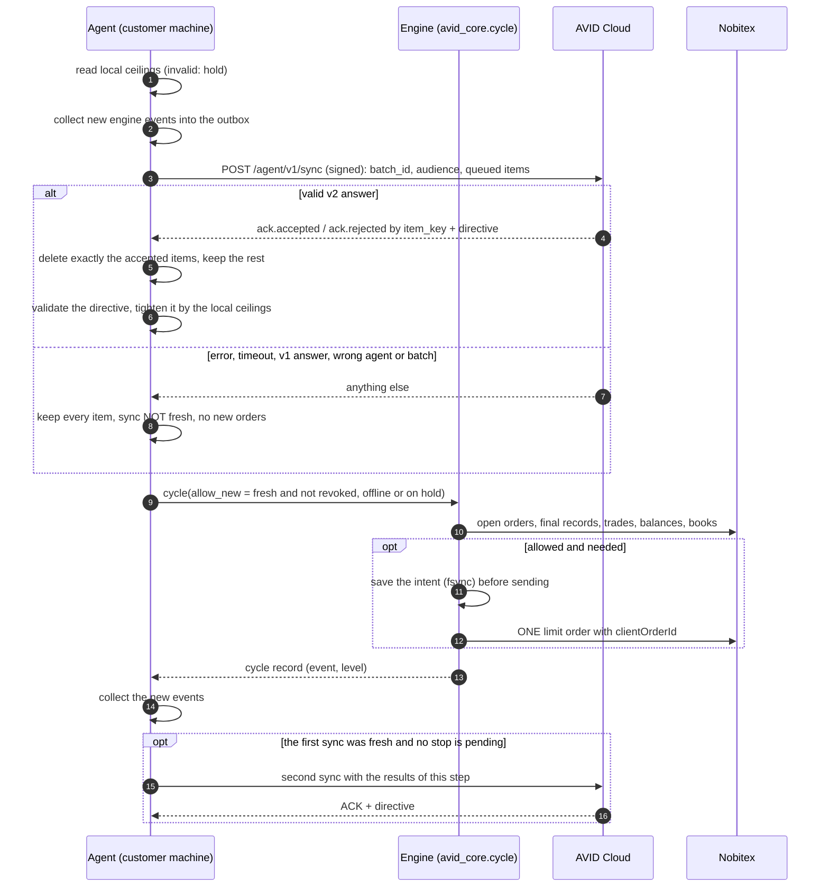

# AVID agent ↔ cloud protocol, version 2

Status: required by agent `0.1.0a1` and later (unchanged in `0.1.0a2`). A v1.2 cloud answer (the directive object at the top level, no
acknowledgement) is **refused**: the agent keeps every queued report and places no new order until
the cloud speaks v2. This is deliberate (AVID-06): an HTTP 200 is not an acknowledgement.

## One step

What `Agent.step()` (`agent/avid_agent/engine.py`) does each interval. The cloud never talks to Nobitex
and never holds the Nobitex key; the agent decides locally what the directive may change.



On SIGTERM the step in progress finishes with a deadline on its exchange calls and skips its second
sync; then `safe_shutdown()` cancels the bot's orders and sends one final report (see
[ORDER_LIFECYCLE.md](ORDER_LIFECYCLE.md#stop-restart-crash)).

## Transport and signature (unchanged from v1)

`POST /agent/v1/sync`, JSON body (strict: no `NaN`/`Infinity`), headers

```
X-AVID-Agent:     <agent_id>
X-AVID-Timestamp: <unix seconds>
X-AVID-Nonce:     <24 hex>
X-AVID-Signature: base64url(Ed25519(ts \n nonce \n POST \n <path> \n sha256hex(body)))
```

New body fields make the signed hash bind the request to one deployment, one agent and one batch:

| field | meaning | the cloud MUST |
|---|---|---|
| `protocol` | `2` | refuse anything else with 400 |
| `agent_id` | the agent id | refuse if it differs from `X-AVID-Agent` |
| `batch_id` | random hex, new for every request | echo it in the answer |
| `audience` | the origin the agent talks to, e.g. `https://avid.example.ir` | refuse if it is not its own public origin (stops replay against another deployment) |
| `version`, `network`, `signer`, `local_ceilings`, `outbox` | information | treat `local_ceilings` as **claims of the agent**, never as authorisation (see below) |
| `snapshots`, `intents`, `orders`, `fills`, `events` | report items | store idempotently by `item_key` |

The cloud should also sign-check the **query string** if it ever accepts one (`request.url.path`
alone ignores it) and keep nonces for at least twice the timestamp window.

## Items

Every item carries `item_key`: a stable key derived from the engine event id (or `fill:<trade_id>`).
The same key is sent again after a lost answer; storing must be idempotent on
`(agent_id, item_key)` (e.g. `INSERT … ON CONFLICT DO NOTHING`). Business keys stay as before
(`exchange_order_id`, `trade_id`, `intent_key`, `key`).

New fields the dashboard should show:

* orders: `state` (`OPEN`, `PARTIALLY_FILLED`, `CANCEL_REQUESTED`, `UNKNOWN`, `MANUAL_RECONCILIATION`,
  `FILLED_CONFIRMED`, `CANCELED_CONFIRMED`, `PARTIALLY_FILLED_CANCELED`, `REJECTED_CONFIRMED`),
  `accounting` (`reconciliation_pending`, `reconciled`, `aggregate_only`, `incomplete_reconciliation`)
  and `reconciliation` {`reconciliation_status`, `expected_filled_amount`, `observed_filled_amount`,
  `missing_filled_amount`, `executions_count`, `pagination_complete`, `last_reconciliation_at`};
* fills: `aggregate: true` marks an amount known only from order totals — never mix it with real
  executions in realized figures;
* snapshots, intents, fills: `network` (`mainnet`/`testnet`) — a testnet report must never be shown as
  real money; snapshots also carry `available` and `mode`.

## Answer

```json
{
  "protocol": 2,
  "agent_id": "<the authenticated agent>",
  "batch_id": "<the batch_id received>",
  "ack": {
    "accepted": ["<item_key>", "..."],
    "rejected": [{"item_key": "<item_key>", "reason": "schema: price missing"}]
  },
  "directive": {
    "global_halt": false,
    "portfolio": {
      "name": "…", "mode": "live", "kill_switch": false,
      "policy": {
        "version_id": "pol-17",
        "weights": {"btc": 0.5, "usdt": 0.5},
        "band_rel": 0.25,
        "max_order_usdt": 15, "max_orders_per_day": 4, "max_daily_usdt": 60,
        "min_cash_usdt": 0, "max_spread": 0.01,
        "expires_at": 1767225600000
      }
    }
  }
}
```

Rules the agent enforces (so the cloud must follow them):

* `accepted` lists only keys that are **durably committed**. The agent deletes exactly those.
* `rejected` is for items the cloud will never accept (schema errors). The agent moves them to a
  local audit table and reports it; they are not resent.
* keys not in this batch, a key both accepted and rejected, another `agent_id` or `batch_id`, a
  missing `ack`, or `protocol != 2` → the whole answer is refused: nothing is deleted, the sync is
  not fresh, no new orders.
* The directive is validated field by field (types, finite numbers, documented ranges, known assets,
  weights summing to 1, `max_daily_usdt >= max_order_usdt`). An invalid directive is not applied; the
  ACK still counts.
* `expires_at` (epoch ms, optional): after it the agent places no new order on that policy.
* Whatever the directive says, the agent applies `min(cloud, local)` for caps and `max_spread`,
  `max(cloud, local)` for `min_cash_usdt`, and trades live only when `live_allowed` is true in its own
  `ceilings.json`. The kill switch writes `data/bot/STOP.cloud`; the customer's `STOP` is never touched.

Errors: `401/403` with `{"error": "agent_revoked" | "agent_unknown"}` is a permanent revocation (cleared
only by pairing again). `413` makes batches smaller. `429`/`503` with `Retry-After` make the agent wait.

## Pairing

`POST /agent/v1/pair` additionally carries `protocol: 2` and `audience`. The answer must contain an
`agent_id` of at most 80 characters from `[A-Za-z0-9_.:-]` (it is sent as an HTTP header).

## What the cloud must not trust

`local_ceilings.live_allowed` is reported by an agent the customer controls (attacker A2 can forge
it). It may be shown, and used to warn ("this agent will not trade live"), but it must not be the only
gate for anything security-relevant on the cloud side.
