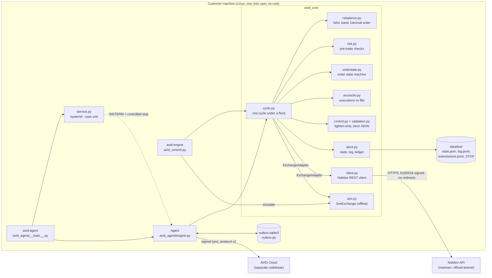

# Architecture

AVID has two Python packages and no runtime dependency outside the standard library
(`cryptography` is optional and needed only to sign live orders).

| package | what it is | runs without AVID Cloud? |
|---|---|---|
| `avid_core` | the engine: strategy, risk checks, order state machine, Nobitex client, ledger, reconciliation, offline simulator; command `avid-engine` | yes |
| `avid_agent` (source folder `agent/avid_agent`) | the Private Agent: runs the engine on the customer's machine under local hard limits, talks to AVID Cloud; command `avid-agent` | no (pairing and directives come from the cloud) |

AVID Cloud (dashboard, accounts, strategy approval) is a separate codebase and is **not** part of this
repository. The agent treats it as untrusted: see [SECURITY_ARCHITECTURE.md](SECURITY_ARCHITECTURE.md).

## Component architecture

The engine talks to an exchange only through the `ExchangeAdapter` surface
([EXCHANGE_ADAPTER.md](EXCHANGE_ADAPTER.md)); `NobitexClient` and the offline `SimExchange` implement
it. Nobitex is the only supported exchange.

## Module map

| module | responsibility |
|---|---|
| `avid_core/cycle.py` | one rebalancing cycle: lost replies, final records, kill switch, cancels, planning, durable intent, send; `resolve_manually`; emergency cancel when the disk fails |
| `avid_core/rebalance.py` | strategy: NAV over every managed asset, relative band, one order, exact Decimal sizing on the market grid ([STRATEGY_MATH.md](STRATEGY_MATH.md)) |
| `avid_core/risk.py` | account-level pre-trade checks, reported one by one ([RISK_MODEL.md](RISK_MODEL.md)) |
| `avid_core/orderstate.py` | the explicit order state machine and its allowed transitions ([ORDER_LIFECYCLE.md](ORDER_LIFECYCLE.md)) |
| `avid_core/records.py` | interpretation of exchange order records (status words, amounts that must add up) |
| `avid_core/reconcile.py` | reconciliation of filled amounts against the trade history ([RECONCILIATION.md](RECONCILIATION.md)) |
| `avid_core/store.py` | `state.json`, the event log, the submission ledger and recovery from it |
| `avid_core/events.py` | severity (`info` / `warning` / `error`) of every logged event |
| `avid_core/control.py`, `validation.py` | control file (tighten-only, fail closed), central validation of risk numbers, strict JSON |
| `avid_core/client.py` | Nobitex REST client: signing, rate limits, response validation, send deadline |
| `avid_core/ed25519.py` | signer backend (`cryptography`, or pure Python only for simulation / official testnet) |
| `avid_core/fsio.py` | atomic fsync'd writes, `O_NOFOLLOW` appends, private file reads |
| `avid_core/models.py` | typed contracts (TypedDicts) and the `ExchangeAdapter` protocol |
| `avid_core/sim.py` | offline simulator: `SimExchange`, scenario files, runner |
| `avid_core/performance.py` | time-weighted return, benchmarks, data quality flags |
| `avid_core/cli.py` | `avid-engine` ([CLI_REFERENCE.md](CLI_REFERENCE.md)) |
| `avid_agent/engine.py` | `Agent.step()`, `safe_shutdown()`, cloud sync, local ceilings, offline grace |
| `avid_agent/cloud.py`, `directive.py` | signed client of protocol v2, validation of everything the cloud says ([AGENT_PROTOCOL.md](AGENT_PROTOCOL.md)) |
| `avid_agent/outbox.py` | SQLite report queue with classes, storage pressure and log cursor |
| `avid_agent/config.py` | `~/.avid-agent`: identity, ceilings, keep-orders flag |
| `avid_agent/service.py` | `install` / `uninstall` / `start` / `stop` / `restart` / `logs` with systemd `--user` ([INSTALLATION.md](INSTALLATION.md)) |

## Files of one engine folder (`<root>/data/bot`, mode 0700, files 0600)

| file | written by | purpose |
|---|---|---|
| `state.json` | engine (atomic, fsync) | open / closing / pending orders with their state, the day's counters, reconciliation in progress, last valid control, clock guard |
| `submissions.jsonl` | engine (append, fsync) | ledger: submit / outcome / final / reconciled - survives a lost `state.json` |
| `log.jsonl` (+ `.1`-`.3`) | engine (append, fsync) | every event with an `eid` and a `level`; rotated at 20 MB, three generations |
| `effective.json` | engine | what was in force in the last cycle (mode, holds, caps, market specs, signer) |
| `control.json`, `control_audit.jsonl` | dashboard / agent | weights, band, tighter caps, dry/live |
| `STOP` | the customer | kill switch; never touched by the cloud |
| `STOP.cloud` | agent | the cloud's kill switch |
| `markets.json` | operator (optional) | validated override of the market specs |
| `runtime.json` | `avid-engine run` | how the standalone loop was started |
| `SIMULATION` | `avid-engine simulate --root` | marks a folder that holds simulated data only |
| `.lock` | engine | `flock`: one engine per folder |

Agent home (`~/.avid-agent`, 0700): `agent.json`, `agent_key`, `ceilings.json`, `agent_state.json`,
`outbox.sqlite3`, `last_stop.json` (verdict of the last controlled stop), the keep-orders flag, and
`data/bot` above.

## One engine cycle (`avid_core.cycle._cycle`)

1. load the state (strict; corrupt or missing -> recovery from the ledger, the day is locked); clock
   guard (the cap day never moves backwards, the exchange `Date` header is cross-checked);
2. control file (fail closed), market specs, effective configuration and validation of every number;
3. list open orders on **every** managed market (an error -> STOP / dry mode still cancel, then re-raise);
4. a placement whose reply was lost -> look it up by clientOrderId only, adopt only a matching record;
5. orders that left the open list -> final record -> state machine (UNKNOWN never releases anything);
6. reconciliation of executions (paged trade history);
7. STOP -> cancel the bot's own orders (UNKNOWN ones too); dry mode or stale order -> cancel;
8. anything open, unsettled, pending or foreign -> wait;
9. value every managed asset, plan one order, risk checks, holds, signer check, clientOrderId
   verification;
10. durable intent (state + ledger + `order_state` event) -> send -> `OPEN` / `REJECTED_CONFIRMED` /
    unconfirmed (stays pending, looked up next cycle).

The decision part (steps 9-10) is drawn in [STRATEGY_MATH.md](STRATEGY_MATH.md#decision-flow); the
crash recovery path in [SECURITY_ARCHITECTURE.md](SECURITY_ARCHITECTURE.md#crash-recovery-flow).

## One agent step (`avid_agent.engine.Agent.step`)

local ceilings -> collect new engine events into the outbox -> sync with the cloud (reports out,
ACK + directive in) -> effective configuration = directive tightened by the local ceilings -> engine
cycle (new orders only if the sync was fresh, the agent is not revoked or offline, and nothing is on
hold) -> collect -> second sync. The sequence is drawn in [AGENT_PROTOCOL.md](AGENT_PROTOCOL.md#one-step).
