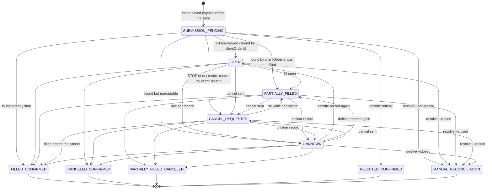

# Order lifecycle

Every order the bot places is tracked by an explicit state machine (`avid_core/orderstate.py`). A
transition that is not in the table below is **refused and logged** (`order_state_anomaly`, level
error); the order keeps its state. `tests/test_docs.py` checks that every arrow of the diagram below is
in `ALLOWED` and every allowed transition is either drawn or listed under it; the property test
`test_order_state_machine_never_leaves_a_terminal_state` drives random transition sequences.

## States

| state | meaning | caps (orders / notional of the day) | blocks new orders? |
|---|---|---|---|
| `SUBMISSION_PENDING` | intent saved durably (state + ledger, fsync) **before** the send; reply not seen yet | counted | yes |
| `OPEN` | acknowledged by the exchange, nothing filled yet | counted | yes |
| `PARTIALLY_FILLED` | open, part executed | counted | yes |
| `CANCEL_REQUESTED` | a cancel was **requested**; it is not a cancellation | counted | yes |
| `UNKNOWN` | the exchange's answer was not understood (unknown status word, amounts that do not add up, lookup failed) | counted, **nothing released** | yes |
| `FILLED_CONFIRMED` | final record: completely filled | counted | no |
| `CANCELED_CONFIRMED` | final record: cancelled, nothing filled | unfilled part released | no |
| `PARTIALLY_FILLED_CANCELED` | final record: part filled, the rest cancelled | only the unfilled part released | no |
| `REJECTED_CONFIRMED` | the exchange definitely refused it; it never existed | released | no |
| `MANUAL_RECONCILIATION` | the customer settled it by hand after checking the Nobitex panel (`avid-agent resolve`) | as recorded | no |

Terminal states: the four `*_CONFIRMED` / `PARTIALLY_FILLED_CANCELED` states and
`MANUAL_RECONCILIATION`. Nothing leaves a terminal state.

## Order state machine

Allowed but not drawn, to keep the picture readable (a fill and a cancel can both happen between two
cycles, and a lost reply can be found already closed):

<!-- not-drawn-transitions -->
* `SUBMISSION_PENDING -> CANCELED_CONFIRMED`
* `SUBMISSION_PENDING -> PARTIALLY_FILLED_CANCELED`
* `OPEN -> PARTIALLY_FILLED_CANCELED`
* `PARTIALLY_FILLED -> CANCELED_CONFIRMED`
* `CREATED -> SUBMISSION_PENDING` (`CREATED` exists for completeness; the engine starts at `SUBMISSION_PENDING`)
<!-- /not-drawn-transitions -->

A record without any state (a new intent, or one written by v1.2) may move once to any state except
`REJECTED_CONFIRMED`. The authoritative list is `ALLOWED` in `orderstate.py`.

## Placement and lost replies (Invariants A and B)

1. The engine counts the caps, writes `pending` into `state.json` and a `submit` line into
   `submissions.jsonl`, both with fsync, **then** sends the order with a fresh 32-character
   clientOrderId (`av` + a 4-hex instance tag of the data folder + a 6-digit sequence + 80 random bits).
2. Acknowledged -> `OPEN`; the account's clientOrderId support is verified after the first order (the
   order must be found again by its clientOrderId) before it is relied on again.
3. A definite refusal (HTTP 4xx except 408/409/425/429, an explicit API error, or `NOT_SENT` - nothing
   left this machine) -> `REJECTED_CONFIRMED`, the caps are given back.
4. Anything else (timeout, 5xx, unreadable answer, "duplicate") -> the order **may exist**. It stays
   pending; nothing new is sent. Next cycles look it up **only** by its clientOrderId (open list,
   status by clientOrderId, full list) and adopt it only if amount, price, side and market match what
   was sent. It is never re-sent automatically and never matched by similar fields.
5. After three lookups without a result the customer is alerted. Only after checking the Nobitex panel
   can they run `avid-agent resolve --not-placed`, which looks the order up again first and refuses if
   it exists.

## Cancels and final records

* A cancel request moves the order to `CANCEL_REQUESTED`. Only the order's **final record** settles it
  (`order_status` after it left the open list): `CANCELED_CONFIRMED`, `PARTIALLY_FILLED_CANCELED` or
  `FILLED_CONFIRMED`.
* A final record whose status word is unknown, or whose amounts do not add up
  (amount ≠ matched + unmatched, "filled" with an unfilled rest, "rejected" with a fill) is `UNKNOWN`:
  nothing is released and no new order is placed until a definite record arrives (Invariant B), or the
  customer runs `avid-agent resolve --closed ID` after checking the panel.
* Each order is settled exactly once (`settled` flag); a confirmed cancel releases only the unfilled
  notional of that day.
* Not being allowed to trade never removes the right to cancel: STOP, dry mode, a run without `--live`,
  revocation, an invalid control file and an exchange listing error all still cancel the bot's own
  orders. Only the read-only `avid-engine plan` preview never touches orders.

## Stop, restart, crash

* **STOP** (`data/bot/STOP` from the customer, `STOP.cloud` from the cloud): no new orders; the bot's
  own orders (UNKNOWN ones and a pending lost reply by clientOrderId too) are cancelled every cycle until
  their final records arrive.
* **`avid-agent stop`** / SIGTERM: controlled stop, time-bounded (exchange deadline, then a final
  report). The verdict goes to `~/.avid-agent/last_stop.json`; the command exits 0 only if no bot order
  is left open (or they were kept on purpose), 3 if a cancellation was not confirmed, 4 if the service
  did not report.
* **`avid-agent restart`**: the orders are kept and managed again after the restart (one-shot flag,
  valid for 10 minutes).
* **Crash / power loss**: on start the engine reloads `state.json`; if it is corrupt or missing it is
  rebuilt from `submissions.jsonl`, unsettled orders are tracked again and new orders stay off for that
  UTC day. See [SECURITY_ARCHITECTURE.md](SECURITY_ARCHITECTURE.md#crash-recovery-flow).
