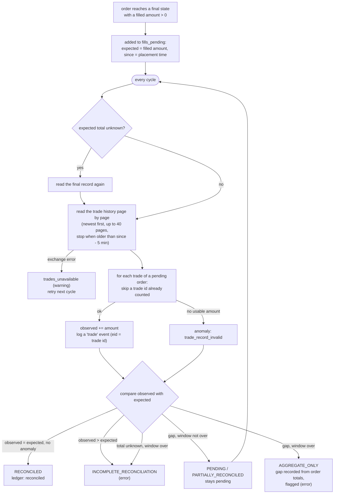

# Reconciliation

An order's final record says **how much** filled (aggregate, `matchedAmount`). The trade history says
**which executions** made that amount (execution-level: one record per trade, with price and fee).
Reconciliation (`avid_core/reconcile.py`, AVID-08) matches the two for every order that filled
anything, and never reports the accounting complete when it is not (Invariant F).

## Words that are kept apart

| | meaning |
|---|---|
| **intent** vs **executed** | an intent (`submit` in the ledger, `SUBMISSION_PENDING`) is what the bot tried; executed is what fills say happened |
| **confirmed** vs **unknown** | confirmed = a definite final record; unknown = anything the engine could not read with certainty (it keeps the caps counted) |
| **execution-level** vs **aggregate** | execution-level = individual trades with their own price and fee; aggregate = a total known only from the order record (`aggregate: true` in reports) |
| **estimated** vs **realized** | estimated = valued at mid prices (NAV, simulation results); realized = from recorded executions of a LIVE run |
| **simulation** vs **live** | simulation (offline `simulate`, dry run, `plan`) sends nothing to an exchange; its numbers are never realized results |

## Statuses

| status | when | closes the order's accounting? |
|---|---|---|
| `PENDING` | nothing observed yet, within the history window | no |
| `PARTIALLY_RECONCILED` | some executions observed, not all | no |
| `RECONCILED` | observed executions = filled amount (within 1e-9 relative), no anomaly | yes |
| `AGGREGATE_ONLY` | the history window (2.5 days; Nobitex lists 3) passed with a gap: the missing part is recorded from the order totals and **flagged**, at level error | yes, flagged |
| `INCOMPLETE_RECONCILIATION` | the expected total is unknown when the window ends, more was executed than filled, or a trade record is unusable | yes, flagged as incomplete |

Per order the engine keeps and reports `expected_filled_amount`, `observed_filled_amount`,
`missing_filled_amount`, `executions_count`, `pagination_complete` and `last_reconciliation_at`
(`models.ReconciliationResult`).

## Reconciliation flow

## Rules

* The exchange trade id is the event id and the idempotency key: a repeated page or a retry never
  counts an execution twice; the cloud stores fills idempotently by `item_key = fill:<trade_id>`.
* Paging is bounded (40 pages per asset per cycle) and stops once trades older than the oldest pending
  order (minus five minutes) are reached; `pagination_complete` says whether that point was reached.
* An order whose final state is `UNKNOWN` is not in reconciliation yet: there is no definite filled
  amount to reconcile against.
* After a lost `state.json`, orders in reconciliation are restored from the ledger.
* Performance figures mark `data_quality.exact = false` while any order is `AGGREGATE_ONLY` or
  `INCOMPLETE_RECONCILIATION`.

## What the customer should do

`AGGREGATE_ONLY` and `INCOMPLETE_RECONCILIATION` are reported at level error. Compare the order in the
Nobitex panel (Orders and Trades) with the engine log (`order_final`, `trade`, `reconciliation`
events). The engine does not correct them by itself.
