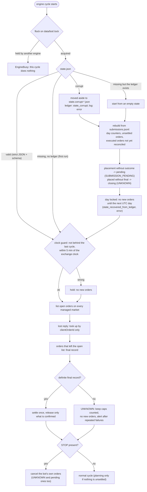

# Security architecture

AVID places real orders on a real exchange account. Here an unwanted order, a stop that does not
stop, or a report that misstates money is a security problem. Reporting a vulnerability:
[SECURITY.md](../SECURITY.md).

## Assets, in order

1. the customer's money: no unwanted, oversized, duplicated or unstoppable order;
2. the Nobitex API key (`~/.nobitex`, never sent to the cloud);
3. the agent's private key (`~/.avid-agent/agent_key`);
4. the correctness of financial records and reports;
5. the availability of STOP and of cancelling the bot's own orders.

## Trust boundaries and what holds

| boundary | attacker | what holds | tests |
|---|---|---|---|
| cloud -> agent | compromised or buggy cloud | effective caps = min(cloud, local), cash floor = max; live only with the local `live_allowed`; every directive field validated (types, finite numbers, ranges, known assets, weights summing to 1); an invalid directive is not applied and stops new orders; the customer's `STOP` is never touched; oversized, nested or non-strict JSON is refused | `security/test_findings.py` F10 F12 F20 F21 F28 F29 F30, `tests/test_agent_fuzz.py` |
| agent -> cloud | lost answers, replays | reports deleted only on a valid v2 ACK by `item_key`; resend is idempotent; each request is bound to agent, batch and audience and signed (Ed25519 over timestamp, nonce, method, path, body hash) | F06 F06b, `tests/test_cloud.py`, `tests/test_agent.py` |
| agent <-> Nobitex | odd or failing exchange, network attacker | TLS verified, only the official hosts, no redirects, strict JSON ≤ 2 MB; balances and books validated; unknown or inconsistent order records are `UNKNOWN`; placement never retried; lost reply found only by clientOrderId; clientOrderId support verified per account; a send deadline bounds a stop | F01 F07 F13 F22 F25, `tests/test_client.py`, `tests/test_order_state.py`, `tests/test_fuzz_invariants.py` |
| OS <-> agent | another local user | folders 0700, files 0600, `mkstemp` + `O_NOFOLLOW` (no symlink planting); secrets read through one `O_NOFOLLOW` descriptor that checks owner, type and mode (no check-then-open race); installation without root into the user's home; systemd user unit with `NoNewPrivileges=yes`, `UMask=0077` | F15, `tests/test_service.py`, `tests/test_control_config_cli.py`, `tests/test_client.py` |
| OS <-> agent | careless operator, broken files, failing disk | invalid ceilings / control / state / market files fail closed (no new orders) while STOP and cancels keep working; network name typos refused; a stale keep-orders flag is ignored; a clock that goes back stops new orders; a lost `state.json` is rebuilt from the ledger; a full disk still lets STOP cancel (write-free emergency cancel) | F02 F09 F11 F13 F14 F17 F18 F19, `tests/test_performance_and_ops.py` |
| supply chain | broken or hostile dependency, CI | no runtime dependencies; `cryptography` optional; a broken `cryptography` install (e.g. a pyo3 panic) is detected and refused for live orders instead of crashing the engine; CI actions pinned to commit SHAs, least-privilege tokens, no secrets in pull-request jobs, secret scan of tree and history, dependency audit, CodeQL | `tests/test_ed25519.py`, `.github/workflows/` |

## Controls in code

* **Fail closed, cancel always** (Rule 1): see [RISK_MODEL.md](RISK_MODEL.md#fail-closed-but-keep-the-right-to-cancel-rule-1).
* **Signer**: live orders in API-key mode need the constant-time `cryptography` Ed25519 signer. The
  pure-Python signer is not constant time; it signs only for simulation and for the official testnet
  with `AVID_ALLOW_PURE_ED25519=1` (PRA-04). The gate looks at the signer that will actually sign
  (`client.signer`), not at the authentication mode.
* **Strict input**: `validation.loads_strict` refuses NaN / Infinity, duplicate keys and nesting deeper
  than 64; every risk number goes through `validation.number`.
* **Durability**: state and ledger writes are atomic with fsync of file and directory; appends use
  `O_APPEND | O_NOFOLLOW`; the log carries an `eid` and a `level` for every event.
* **Bounded stop**: on SIGTERM the exchange client gets a deadline (`NOT_SENT` once passed, no retry
  sleep past it); `safe_shutdown` has a 150 s budget and a final report of at most 20 s; systemd's
  `TimeoutStopSec=300` covers the worst case. `avid-agent stop` reports the agent's own verdict and
  exits 3 / 4 when a cancellation was not confirmed or the result is unknown (PRA-05).
* **Secrets on disk**: `~/.nobitex/{api_key,secret,token}` and the agent key must be regular files owned
  by this user (or root, for container secrets), not a symlink, and neither readable nor writable by group or others (e.g. mode 0600 or
  0400); `NOBITEX_ALLOW_LOOSE_TOKEN_PERMS=1` relaxes only the read bits, for read-only container secrets. The repository scanner (`scripts/check-secrets.py`) refuses credential files,
  key blocks and runtime data.

## Crash recovery flow

What happens when the engine starts after a crash, a kill or a power loss (`store.Store.load`,
`store._recover_from_ledger`, `cycle._cycle`).

A write that fails in the middle of a cycle (disk full, read-only filesystem) raises; before it does,
if STOP is present, trading is off or the control file is invalid, the engine sends cancel requests for every bot order it knows
**without writing anything** (`emergency_cancel`), and the agent reports it at level error.

## Out of scope (stated, not solved)

* **Malware or another process running as the same Unix user** can read the Nobitex key and rewrite
  `ceilings.json`; no file permission protects against that. Use a dedicated Unix account for the
  agent and an API key restricted to the machine's IP in the Nobitex panel.
* **A cloud within the allowed limits** can still move exposure by up to `max_daily_usdt` per UTC day.
* **Two agents on one account** are detected (instance tag in the clientOrderId) and block each
  other's new orders, but the exchange offers no account-wide lock.
* **NFS / network volumes**: `flock` semantics are not guaranteed; keep the data folder on a local disk.
* **Real power loss** has been reasoned about (fsync of file and directory, ledger) and simulated (kill
  after send, torn log line), not tested on hardware.
* **Timing of the pure-Python signer** was not measured; it is refused for live mainnet orders.
* **A forward clock jump** while the exchange's `Date` header is unavailable can open the next UTC
  day early (one extra day of caps at most).
