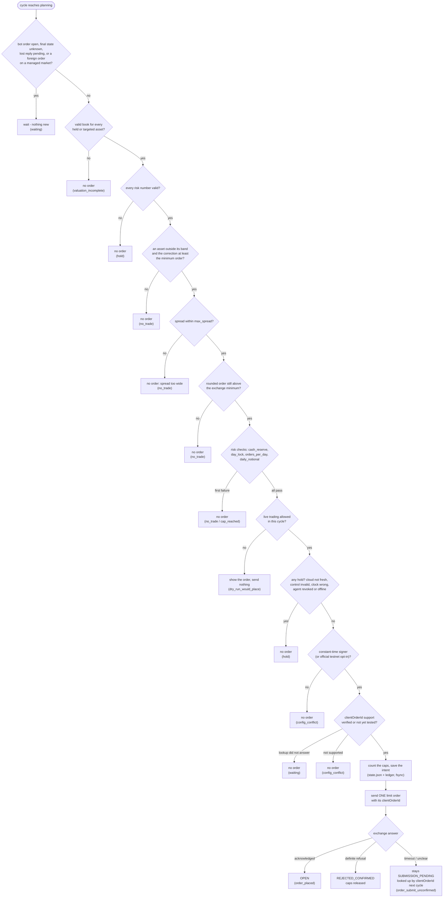

# Strategy and mathematics

AVID keeps a portfolio at **fixed target weights**. It does not predict prices, it does not try to
make a profit, and rebalancing is **not a profit guarantee**: in a trending market a rebalanced
portfolio can end below simply holding. What it does is keep the weights close to the targets the
customer chose, with small, bounded, auditable orders.

Code: `avid_core/rebalance.py` (`plan_multi`, `exact_order`), `avid_core/risk.py`, `avid_core/cycle.py`.

## 1. Fixed weights with USDT as the hub

The portfolio holds managed assets (BTC and PAXG today) and USDT. Each asset is traded only on its
`<ASSET>USDT` market. For every asset *i*:

* mid price: m<sub>i</sub> = (bid<sub>i</sub> + ask<sub>i</sub>) / 2
* portfolio value (NAV): V = USDT + Σ<sub>i</sub> q<sub>i</sub> · m<sub>i</sub>, where q<sub>i</sub> is the
  **total** balance (free + locked in open orders)
* weight: w<sub>i</sub> = q<sub>i</sub> · m<sub>i</sub> / V

A managed asset that the targets do not name has the explicit target t<sub>i</sub> = 0 (AVID-03). If an
asset is held or targeted but has no valid price, the NAV is not computed (`ValuationIncomplete`) and no
order is placed - an incomplete valuation is never treated as a complete one.

The NAV is an **estimate at mid prices**. What an order really executes at is known only from the
exchange's fills (see [RECONCILIATION.md](RECONCILIATION.md)).

## 2. Relative band

Asset *i* is traded only when

    |w_i - t_i| > band_rel · t_i

(for t<sub>i</sub> = 0 any holding is outside the band). At most **one** limit order is placed per
cycle. Sells come before buys (they free USDT); among them the largest relative deviation goes first.
A buy rests at the best bid, a sell at the best ask. Nobitex has no post-only flag, so a fast market can
still execute the order as taker; the fee reserve is therefore the taker rate (`fee_reserve = 0.3%`).

A wide market is not traded: if (ask − bid) / mid > `max_spread`, the cycle waits.

## 3. Order size

    want     = |w_i - t_i| · V
    notional = min(want, max_order_usdt, what the free balance allows)

computed in `decimal.Decimal` on the market grid (`exact_order`):

* buy price = best bid floored to `price_tick`; sell price = best ask raised to `price_tick`;
* amount = floor(min(want, max_order_usdt) / price / `amount_step`) · `amount_step`;
* a buy never uses more than free USDT / (1 + fee_reserve); a sell never more than the free asset;
* the order is sent only if notional > the exchange minimum (more than 11 USDT on Nobitex USDT markets)
  **and** notional ≥ `min_order_usdt` (default 11.5).

The amount and price leave the engine as the exact decimal text of these values (`client.fmt_decimal`);
a property test checks that the float stored in `state.json` gives back exactly the same text
(PRA-17, `tests/test_properties.py`).

## 4. The 11.5 USDT threshold is not a minimum capital

The relation band_rel · t<sub>i</sub> · V ≥ 11.5 only says whether a deviation **exactly at the band
edge** is worth one minimum order. With band_rel = 0.25:

| targets | t<sub>i</sub> | V at the band edge |
|---|---|---|
| 50 / 50 | 0.5 | ≈ 92 USDT |
| thirds | 0.333 | ≈ 138 USDT |

These are approximate thresholds at the band edge, not guarantees: a smaller portfolio with a larger
deviation can still produce a valid order, and a larger portfolio may still be unable to trade (locked
balance, `min_cash_usdt`, the fee reserve, rounding to the step, a wide spread, or the daily caps).

## 5. Limits

| limit | meaning |
|---|---|
| `max_order_usdt` | ceiling of one order's value |
| `max_orders_per_day` | orders **submitted** per UTC day; a cancellation does not give the slot back |
| `max_daily_usdt` | filled + still open notional of the day; a **confirmed** cancel releases only the unfilled part; an unknown outcome releases nothing (AVID-01) |
| `min_cash_usdt` | USDT that a buy must leave free (after the order and its fee reserve) |
| `max_spread` | widest book that is traded |

Effective values: min(cloud policy, local ceiling) for the caps and `max_spread`, max(...) for
`min_cash_usdt`. Details and the order of the checks: [RISK_MODEL.md](RISK_MODEL.md).

## Decision flow

What one cycle decides once nothing is open or unsettled (`_cycle`, steps 8-10). Every "no" ends the
cycle with a logged event and **no order**; the event name is in brackets.



## 6. Worked example (offline simulation, real engine output)

`avid-engine simulate --example btc-usdt` starts with 200 USDT and no BTC, target BTC 50 % / USDT 50 %,
`band_rel` 0.25, `max_order_usdt` 20, and a stored synthetic price path (BTC mid 60 000 at the first
step, spread 0.04 %). The first decision, as printed by the command:

```text
First decision (step 1, 2026-01-05T18:00:00Z)
  Portfolio Value  200.00 USDT (estimated at mid prices)
  Current Weights  btc 0.0000  usdt 1.0000
  Target Weights   btc 0.5000  usdt 0.5000
  Band             ±25% of each target (btc 0.375-0.625, usdt 0.375-0.625)
  Decision         BUY order placed on the simulated exchange
  Order Amount     0.000333 BTC (BUY on BTCUSDT)
  Order Price      59988.0 USDT, limit (resting side); notional 19.98 USDT
  Risk Checks      cash_reserve OK (200.00 free - 20.54 (order + fee reserve + margin) = 179.46 USDT; floor 0); day_lock OK (not locked); orders_per_day OK (0 submitted today, cap 6); daily_notional OK (0.00 committed + 19.98 = 19.98 USDT, cap 100)
  Reason           btc weight 0.000 vs target 0.500
```

By hand: book 59 988.00 / 60 012.00 (mid 60 000 ± 0.02 %); want = 0.5 · 200 = 100 USDT, capped at 20;
20 / 59 988 = 0.00033340 → floored to the 1e-6 BTC step = 0.000333 BTC; notional = 0.000333 · 59 988 =
19.976 USDT. The whole run (96 steps) places 5 orders, 4 fill and 1 is cancelled as stale; the BTC weight
ends at 0.40, inside the band, after which the engine stops trading. These numbers come from the
synthetic data in `avid_core/examples/btc-usdt.json`; they show how the engine decides, not what a
market will do.

## 7. Performance figures

* Time-weighted return: r<sub>t</sub> = (bal<sub>t-1</sub> · p<sub>t</sub>) / (bal<sub>t-1</sub> · p<sub>t-1</sub>) − 1;
  deposits and withdrawals are not counted as profit or loss.
* Benchmarks: HODL (the starting balances, never rebalanced) and 100 % BTC.
* `basis = simulation` means no order was sent: the figure is the market return of the assets held,
  **not** a strategy profit. `realized` is true only when every snapshot came from a LIVE cycle.
* `fees_usdt` is the sum of the fees of recorded executions.
* `data_quality.exact = false` means realized figures are not exact because some orders are
  `AGGREGATE_ONLY` or `INCOMPLETE_RECONCILIATION`.
